# nlp_tfidf_logreg_catboost


## Roadmap

- [x] Project structure creating
- [x] Raw data uploading and validation (`bb_data_loader.py`)
- [x] Exploratory Data Analysis (EDA) for TF-IDF and Embeddings
- [x] Text pre-processing (`bc_preprocessing.py`)
- [x] Features creation (TF-IDF)
- [x] Model training and comparison (Logistic Regression vs CatBoost)
- [x] Increasing the number of components (CatBoost + TruncatedSVD)
- [x] Inference (`ec_run_inference.py` Logistic Regression and CatBoost + TruncatedSVD)
- [x] Pretrained Embeddings extraction (`bg_embedding_extractor.py`)
- [x] Pretrained Embeddings training (`ee_train_embeddings.py` Logistic Regression and CatBoost)
- [x] Pretrained Embeddings Inference (`ef_run_inference_embeddings.py` Logistic Regression and CatBoost)
- [x] Exploratory Data Analysis (EDA) for Deep Learning (FCN, RNN, CNN)
- [x] DataLoader for Deep Learning models (`bi_data_loader_dl.py`)
- [x] Fully connected network (FCN) class with Dropout (`bj_models_dl.py`)
- [x] Unified training function with Early Stopping (FCN, RNN, CNN) (`bk_training_utils.py`)
- [x] Model training and comparison (FCN vs TF-IDF vs E5 Embeddings) (`eg_train_fcn.py`)
- [x] Inference Deep Learning (FCN) (`eh_run_inference_dl.py`)
- [ ] Recurrent neural network (RNN) class with Dropout and Attention (`bj_models_dl.py`)
- [ ] Model training and comparison (RNN vs TF-IDF vs E5 Embeddings) (`ei_train_bilstm_rnn.py`)
- [ ] Inference Deep Learning (RNN)
- [ ] Final documentation

# Sports Text Classifier 

Sports news classifier with 13 categories: **winter_sport**, **football**, **tennis**, **autosport** and so on.
**Dataset URL:** https://www.kaggle.com/datasets/mikhailma/russian-social-media-text-classification

Implemented models:
- TF-IDF (Logistic Regression, CatBoost, CatBoost + TruncatedSVD)
- Pretrained Embeddings (Logistic Regression, CatBoost)
- Deep Learning (FCN)

## Fast start

```bash
# Clone the repository
git clone <repo-url>
cd sports-classifier-tfidf

# Create a virtual environment
python -m venv venv
source venv/bin/activate  # Linux/Mac
venv\Scripts\activate     # Windows

# Install dependencies
pip install -r requirements.txt
python -m spacy download ru_core_news_sm

# Model training
# Logistic Regression (baseline)
python e_scripts/ea_train_logistic_regression.py

# CatBoost with SVD
python e_scripts/eb_train_catboost.py

# Training models using dense embeddings (multilingual-e5-small)
# Extracting embeddings from cleaned texts (takes ~5–10 min on CPU)
# The result will be saved to a_data/ab_processed/embedded_train.csv
python e_scripts/ed_extract_embeddings.py

# Training LR and CatBoost models using the 384 features obtained
python e_scripts/ee_train_embeddings.py

# Training FCN
python e_scripts/eg_train_fcn.py

# Testing inference (prediction on new data)
# Testing the TF-IDF pipeline
python e_scripts/ec_run_inference.py

# Testing the pipeline using embeddings (including checks for OOD data)
python e_scripts/ef_run_inference_embeddings.py

# Testing Deep Learning (FCN) model inference
python e_scripts/eh_run_inference_dl.py
```

## Project Architecture
The project implements two independent text classification pipelines, which are compared based on accuracy, training speed, and inference quality.

## Architecture TF-IDF + TruncatedSVD
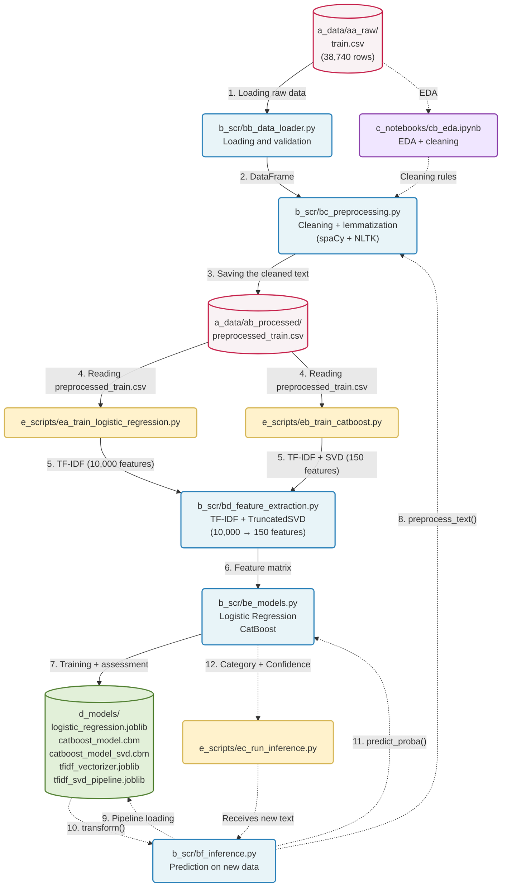

## Architecture Pretrained Embeddings (E5)
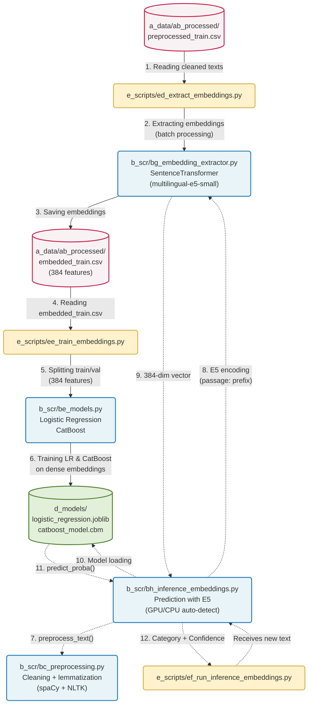

## Architecture Deep Learning (FCN)
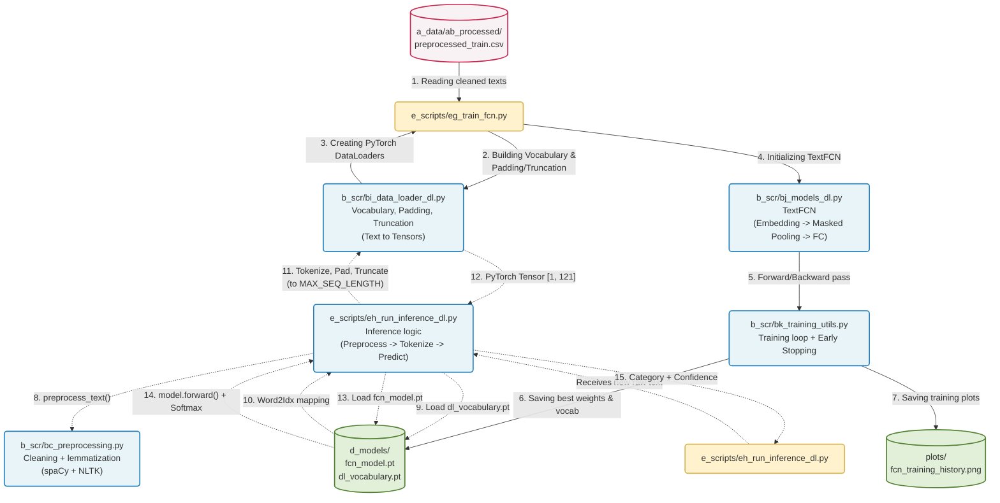

## Project structure
```bash
nlp_tfidf_logreg_catboost/
│
├── a_data/                          # Project data
│   ├── aa_raw/                      # Raw, original data
│   │   └── train.csv                   # Original dataset from Kaggle (38,740 rows)
│   └── ab_processed/                # Processed data
│       ├── preprocessed_train.csv      # Cleaned text after preprocessing
│       └── embedded_train.csv          # text + 384 columns of embeddings
│
├── b_scr/                           # Source code
│   ├── ba_config.py                    # Configuration: paths, constants, parameters
│   ├── bb_data_loader.py               # Raw data loading and validation
│   ├── bc_preprocessing.py             # Text cleaning and lemmatization (spaCy + NLTK)
│   ├── bd_feature_extraction.py        # Feature extraction (TF-IDF + TruncatedSVD)
│   ├── be_models.py                    # Model training (Logistic Regression, CatBoost)
│   ├── bf_inference.py                 # Inference: making predictions on new data
│   ├── bg_embedding_extractor.py       # Extracting embeddings in batches
│   ├── bh_inference_embeddings.py      # Embeddings Inference: making predictions on new data
│   ├── bi_data_loader_dl.py            # DataLoader for Deep Learning model
│   ├── bj_models_dl.py                 # Deep Learning Model Architectures for Text Classification
│   └── bk_training_utils.py            # Utilities for training deep learning models
│
├── c_notebooks/                     #  Jupyter-notebooks for research
│   ├── logs/                        # Script execution logs
│   │   └── data_loader_20261013.log
│   ├── ca_check_data.ipynb             # Data loader verification
│   ├── cb_eda.ipynb                    # Exploratory Data Analysis (EDA)
│   └── cc_deep_learning_exploration.ipynb # Exploratory Data Analysis (EDA) for Deep Learning
│
├── d_models/                        # Trained models and artifacts
│   ├── logistic_regression.joblib      # Best-performing model from the TF-IDF (Accuracy: 81.29%)
│   ├── catboost_model.cbm              # CatBoost model trained on raw TF-IDF features
│   ├── catboost_model_svd.cbm          # CatBoost trained on features after SVD (150 components)
│   ├── tfidf_vectorizer.joblib         # TF-IDF vectorizer for inference
│   ├── tfidf_svd_pipeline.joblib       # TF-IDF + SVD pipeline for inference
│   ├── fcn_model.pt                    # Deep Learning (FCN) model weights
│   └── dl_vocabulary.pt                # Deep Learning (FCN) mode dictionary and class mapping
│
├──  e_scripts/                       # Entry points
│   ├── ea_train_logistic_regression.py # Training Logistic Regression
│   ├── eb_train_catboost.py            # Training CatBoost (with optional SVD)
│   ├── ec_run_inference.py             # Testing inference using examples
│   ├── ed_extract_embeddings.py        # Extracting embeddings from cleaned texts
│   ├── ee_train_embeddings.py          # training LR and CatBoost on embeddings
│   ├── ef_run_inference_embeddings.py  # inference on embeddings + OOD check
│   ├── eg_train_fcn.py                 # training FCN on text data
│   └── eh_run_inference_dl.py          # inference FCN
│
├── plots/                           #  Visualizations from EDA
│   ├── dl_text_lengths.png             # Text lengths for Deep Learning
│   ├── dl_vocabulary.png               # Vocabulary Analysis for Deep Learning
│   ├── fcn_training_history.png        # Cross-Entropy Loss and Classification Accuracy (FCN)
│   ├── image-1.png                     # Text lengths (before cleaning)
│   ├── image-2.png                     # Top 20 words (before cleaning)
│   ├── image-3.png                     # Top 15 words in the 'football' category
│   ├── image-4.png                     # Top 20 words (after cleaning)
│   ├── image-5.png                     # Text lengths (after cleaning)
│   └── image.png                       # Category distribution
│
├── .gitignore                          # Git exclusions (data, cache, logs)
├── LICENSE
├── README.md                           # Project documentation
└── requirements.txt
```

## Part 1. EDA for TF-IDF and Embeddings
### Analysis of the target variable (Classes)
1. Perfect balance – All 13 categories have roughly the same number of posts (1,962–2,412). This means we won't have to deal with class imbalance when training the models.
2. Duplicates removed: 2,966 duplicates (almost 8% of the data) – a good cleaning result.

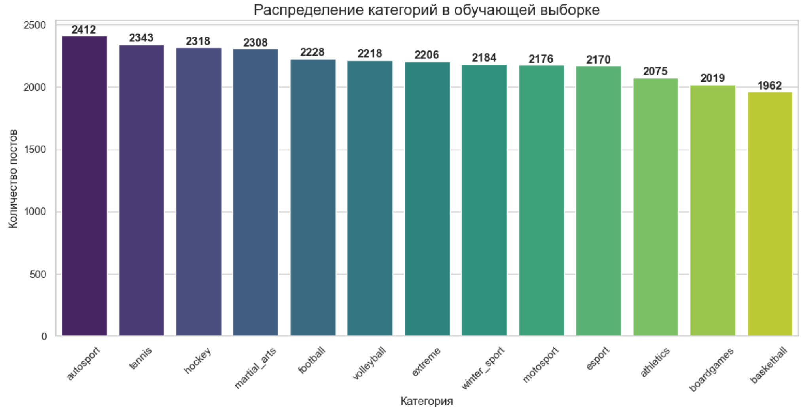

### Text length statistics
Strong right skew:
1. Most texts are short (0–100 words)
2. There is a long tail of infrequent long texts (up to 504 words)
3. This is typical for social media: many short posts, few long articles
Key figures:
1. min = 4 words – very low; 4-word texts are almost useless for classification
2. median = 35 words – half of all texts are shorter than 35 words
3. mean = 61 words – average length (higher than the median due to long texts)
4. max = 504 words – includes full-length articles

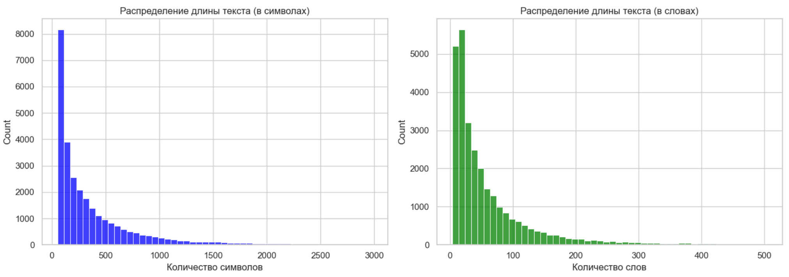

### Number of texts with a length of ≤ 10 words: 2,484
2,484 texts (8.7% of the total) is not a large number. And most importantly: they are meaningful.
Examples:
- "Пожалуй празднования гола лучше в этом сезоне уже не будет"
- "Даниил Медведев передает привет из солнечного Монако"
- "Фабрицио Романо сообщает что Тен Хаг подписал контракт с МЮ"
Short texts do not need to be deleted. They contain information, and the model can classify them.

### Frequency analysis (searching for noise and patterns)
Analysis of the top 20 words and the top 15 category words revealed:
- Many stop words – we will handle this using NLTK
- "33" is an artifact – we will remove it
- There are standalone digits that carry no meaning – we will remove them

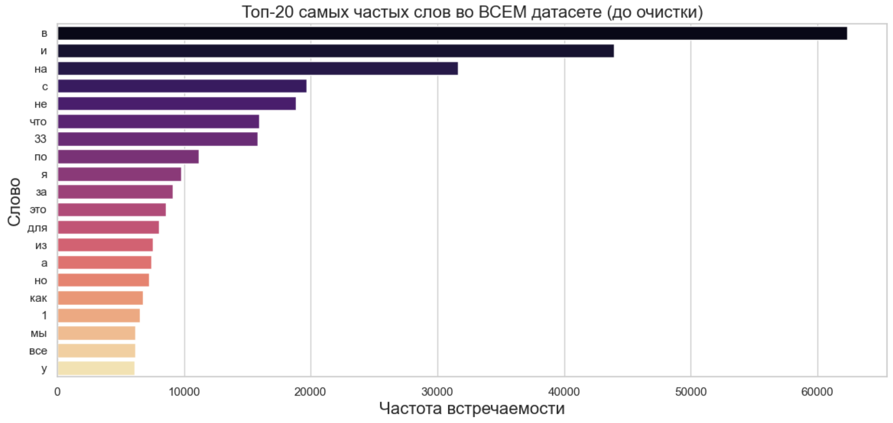
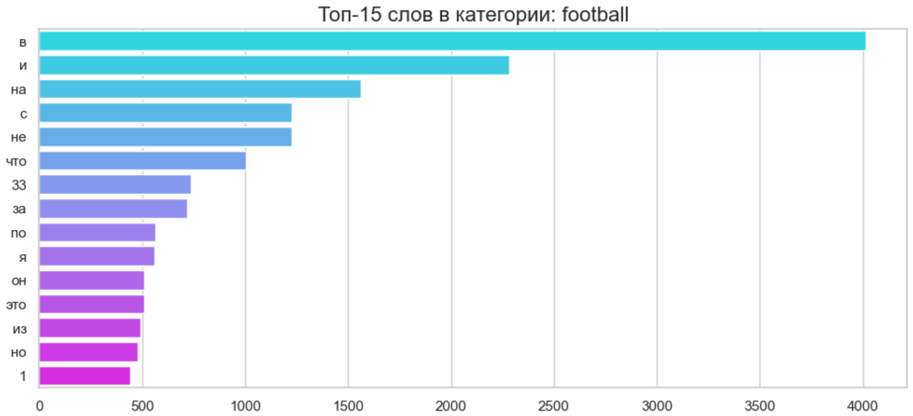

### Frequency analysis and text length distribution AFTER cleaning and lemmatization
Filler words (should be added to the stop-word list):
- Pronouns and particles
    'я', 'мы', 'все', 'это', 'тот', 'та', 'так', 'же', 'бы', 'ли',
    'свой', 'наш', 'ваш', 'его', 'её', 'их', 'мой', 'твой',
- Adverbs and adjectives (too general)
    'очень', 'хороший', 'новый', 'первый', 'последний', 'большой',
- Linking verbs
    'стать', 'быть', 'являться',
- Common nouns
    'день', 'время', 'место', 'год', 'раз', 'часть', 'сторона'

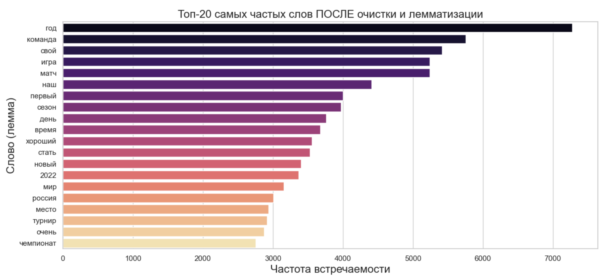
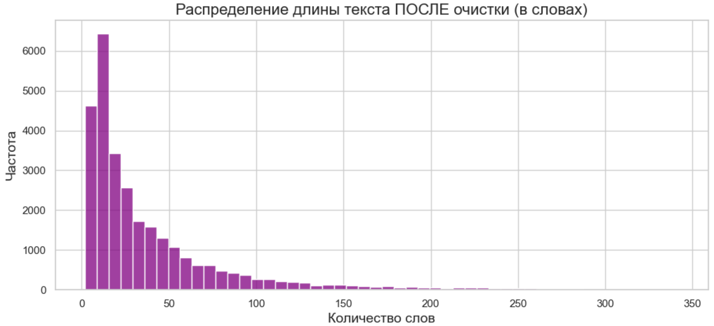

### Final cleaning
- The words "свой", "наш", "хороший", "стать", "первый", "быть", "новый" have disappeared from the top list.
- The average text length decreased from 38.68 to 36.89 words
- There are now more sports terms among the top entries: "команда", "игра", "матч", "сезон", "турнир", "чемпионат", "игрок", "гонка", "победа", "чемпион"

## 1.1. TF-IDF. Model training and comparison (Logistic Regression vs CatBoost vs CatBoost + TruncatedSVD)

### Logistic Regression on TF-IDF features
```bash
2026-10-18 03:00:48,507 - INFO -  - Logistic Regression - Accuracy: 0.8129 (81.29%)
2026-10-18 03:00:48,654 - INFO - Classification Report:
              precision    recall  f1-score   support

   athletics       0.93      0.85      0.89       415
   autosport       0.88      0.82      0.85       482
  basketball       0.88      0.80      0.84       392
  boardgames       0.89      0.94      0.91       404
      esport       0.64      0.75      0.69       434
     extreme       0.54      0.76      0.64       441
    football       0.82      0.74      0.78       446
      hockey       0.84      0.81      0.82       464
martial_arts       0.77      0.73      0.75       462
   motosport       0.88      0.82      0.85       435
      tennis       0.97      0.92      0.94       469
  volleyball       0.90      0.79      0.84       443
winter_sport       0.81      0.84      0.83       437

    accuracy                           0.81      5724
   macro avg       0.83      0.81      0.82      5724
weighted avg       0.83      0.81      0.82      5724
```
**Champions** (F1 > 0.85):
- `tennis` (0.94), `board games` (0.91), `athletics` (0.89), `volleyball` (0.84), `autosport` (0.85), and `motorsports` (0.85).
- These categories have a very specific vocabulary. Terms such as `шлем`, `трасса`, `шайба`, `настольная` and `спринт` appear almost exclusively within their respective categories. TF-IDF assigns them very high weights, making them easy for the model to detect.

**Underperformers** (F1 < 0.75):
- `extreme` (0.64), `esport` (0.69), `martial arts` (0.75), and `football` (0.78).
- Overlapping vocabulary: Words like `игра`, `матч`, `победа`, `команда`, and `турнир` are used across all these categories. TF-IDF identifies these as high-frequency terms and lowers their weight.
- Class similarity: `extreme` and `martial arts` may describe similar actions (e.g., `удар`, `тренировка`, `соревнование`). `esport` may employ terminology similar to that used for conventional games.

### CatBoost on TF-IDF features
```bash
2026-10-18 22:11:49,079 - INFO -  - CatBoost - Accuracy: 0.6890 (68.90%)
2026-10-18 22:11:49,215 - INFO - Classification Report:
              precision    recall  f1-score   support

   athletics       0.94      0.71      0.81       415
   autosport       0.86      0.75      0.80       482
  basketball       0.97      0.58      0.73       392
  boardgames       0.75      0.79      0.77       404
      esport       0.60      0.57      0.58       434
     extreme       0.27      0.78      0.41       441
    football       0.72      0.60      0.65       446
      hockey       0.72      0.71      0.71       464
martial_arts       0.82      0.52      0.64       462
   motosport       0.84      0.71      0.77       435
      tennis       0.88      0.86      0.87       469
  volleyball       0.91      0.67      0.77       443
winter_sport       0.76      0.71      0.73       437

    accuracy                           0.69      5724
   macro avg       0.77      0.69      0.71      5724
weighted avg       0.77      0.69      0.71      5724
```
When comparing `Logistic Regression` and `CatBoost`, accuracy dropped from 81.29% (Logistic Regression) to 68.90% (CatBoost).

1. **Nature of the data (Sparsity)**: The `X_train` matrix has dimensions (22895, 10000). This means there are 10,000 features, approximately 99% of which are zeros (since any single text uses only a tiny fraction of the 10,000 available words).
2. **Logistic Regression** performs well with sparse data. A linear model simply assigns a high weight to relevant words (for example, `шайба` might be associated with `hockey`) and ignores the zeros.
3. **Decision trees (such as CatBoost)** do not handle sparse data well. At each step, a tree attempts to find a single feature that best splits the data. When 99% of the features are zeros, the tree ends up `guessing` and constructing overly complex, convoluted rules, which leads to overfitting on noise.

In the experiments, `Logistic Regression` (81.3%) outperformed `CatBoost` (68.9%) when using raw TF-IDF features. This result is expected, given the high sparsity of the feature matrix (10,000 columns, ~99% zeros) - a condition that linear models handle better than tree-based ensembles. To improve CatBoost's performance, the use of dimensionality reduction (**TruncatedSVD**) is recommended.

### CatBoost on TF-IDF features + TruncatedSVD
**Hypothesis**: Increasing the number of components from 150 to 500 will provide the model with new, useful information and increase Accuracy up to 78-83%.
```bash
2026-10-19 02:08:09,897 - INFO -  - CatBoost (SVD) - Accuracy: 0.6941 (69.41%)
2026-10-19 02:08:10,022 - INFO - Classification Report:
              precision    recall  f1-score   support

   athletics       0.86      0.80      0.83       415
   autosport       0.81      0.74      0.77       482
  basketball       0.72      0.67      0.70       392
  boardgames       0.80      0.80      0.80       404
      esport       0.52      0.55      0.54       434
     extreme       0.39      0.64      0.49       441
    football       0.68      0.58      0.63       446
      hockey       0.71      0.72      0.72       464
martial_arts       0.68      0.59      0.63       462
   motosport       0.81      0.74      0.77       435
      tennis       0.87      0.88      0.87       469
  volleyball       0.76      0.58      0.66       443
winter_sport       0.66      0.73      0.69       437

    accuracy                           0.69      5724
   macro avg       0.71      0.69      0.70      5724
weighted avg       0.71      0.69      0.70      5724
```
- **Accuracy**: 69.04% to 69.41% (a change within the margin of statistical error, meaning no actual improvement).
- **Training time**: 1.5 minutes to 4.5 minutes (a 3-fold increase).
**Conclusion**: The hypothesis was not supported. Increasing the number of components from 150 to 500 did not provide the model with any new, useful information; instead, it merely added computational noise. The first 150 SVD components already captured ~85–90% of the meaningful variance (semantic topics) in this dataset. The remaining 350 components consist primarily of noise and infrequent, unstable word combinations, which only hinder the decision trees from establishing clear rules.

### Comparison of models using TF-IDF features:
In our experiments, `Logistic Regression` (81.3%) significantly outperformed `CatBoost` (~69%).
We tested the hypothesis that decision trees are hindered by high data sparsity (10,000 features). To investigate this, we applied dimensionality reduction to obtain dense features using TruncatedSVD (with 150 and 500 components).

**Result**: Compressing the data accelerated CatBoost training by a factor of 6, but did not yield any improvement in performance. This confirms that for text classification tasks based on word frequencies (TF-IDF), linear models serve as an optimal baseline, as they are better suited for handling sparse, discrete signals.

## Inference Results on Test Texts

Following the training of both models, a blind test was conducted using 7 texts (including out-of-domain samples and "garbage" input).

**Key Findings:**
- **Logistic Regression** demonstrated higher accuracy and better-calibrated confidence scores.
- **CatBoost + SVD** misclassified an obvious text about football (predicting "hockey" instead), which suggests a loss of information during feature compression.
- For an **out-of-domain text** (about a café), `Logistic Regression (LR) returned a confidence score of 16%`, while `CatBoost returned 34%`. This makes LR a safer choice for production environments, where a threshold for filtering out "non-sports" content is essential.

**Decision:** `Logistic Regression` is selected for the TF-IDF-based production pipeline, as it serves as a more reliable and interpretable baseline.

## 1.2. Pretrained Embeddings. Model training and comparison (Logistic Regression vs CatBoost)

### Embeddings extraction
```bash
2026-10-25 22:40:30,526 - INFO -  Embeddings extracted: (28619, 384)
2026-10-25 22:40:41,442 - INFO -  Embeddings are saved in: a_data\ab_processed\embedded_train.csv
2026-10-25 22:40:41,442 - INFO - File size: 127.95 МБ
2026-10-25 22:40:41,442 - INFO - 
 Statistics:
2026-10-25 22:40:41,442 - INFO -   Number of texts: 28619
2026-10-25 22:40:41,442 - INFO -   Embedding dimension: 384
2026-10-25 22:40:41,442 - INFO -   Columns: oid, category, emb_0...emb_383
```
**Analysis of the result**
1. File size:
- 127.95 MB for 28,619 rows and 384 features - this is highly compact and efficient.
2. Structure of `embedded_train.csv`:
- It contains an `oid`, a `category`, and 384 columns (`emb_0` ... `emb_383`).
Each of these 384 columns is not merely a random number, but a coordinate representing meaning within a multidimensional space. Texts with similar meanings now have coordinates that are close to one another across all 384 of these axes.

### Pretrained Embeddings + Logistic Regression
```bash
2026-10-27 02:04:23,317 - INFO -  - Logistic Regression - Accuracy: 0.7572 (75.72%)
2026-10-27 02:04:23,456 - INFO - Classification Report:
              precision    recall  f1-score   support

   athletics       0.79      0.81      0.80       415
   autosport       0.86      0.74      0.79       482
  basketball       0.75      0.71      0.73       392
  boardgames       0.86      0.88      0.87       404
      esport       0.65      0.76      0.70       434
     extreme       0.49      0.65      0.56       441
    football       0.74      0.74      0.74       446
      hockey       0.82      0.75      0.79       464
martial_arts       0.76      0.67      0.71       462
   motosport       0.84      0.79      0.81       435
      tennis       0.92      0.87      0.90       469
  volleyball       0.77      0.68      0.72       443
winter_sport       0.73      0.80      0.77       437

    accuracy                           0.76      5724
   macro avg       0.77      0.76      0.76      5724
weighted avg       0.77      0.76      0.76      5724
```

### Pretrained Embeddings + CatBoost
```bash
2026-10-27 02:07:51,155 - INFO -  - CatBoost - Accuracy: 0.7201 (72.01%)
2026-10-27 02:07:51,290 - INFO - Classification Report:
              precision    recall  f1-score   support

   athletics       0.82      0.79      0.80       415
   autosport       0.84      0.72      0.78       482
  basketball       0.71      0.65      0.68       392
  boardgames       0.80      0.85      0.83       404
      esport       0.63      0.73      0.68       434
     extreme       0.46      0.59      0.52       441
    football       0.64      0.67      0.65       446
      hockey       0.76      0.71      0.73       464
martial_arts       0.68      0.61      0.64       462
   motosport       0.81      0.77      0.79       435
      tennis       0.89      0.86      0.87       469
  volleyball       0.75      0.65      0.69       443
winter_sport       0.68      0.78      0.73       437

    accuracy                           0.72      5724
   macro avg       0.73      0.72      0.72      5724
weighted avg       0.73      0.72      0.72      5724
```
## Experimental results and selection of the model

During the development process, a comparison was made between three approaches to text vectorization and two classification algorithms:
```bash
| Model               | Vectorizer            | Size   | Accuracy (Val) | Training time |
| Logistic Regression | TF-IDF (N-grams)      | 10 000 | 81.29%         | ~3 sec        |
| CatBoost            | TF-IDF + TruncatedSVD | 150    | 69.41%         | ~1.5 min      |
| Logistic Regression | E5 Embeddings         | 384    | 75.72%         | ~2 sec        |
| CatBoost            | E5 Embeddings         | 384    | 72.01%         | ~3.5 min      |
```

### Key takeaways:
1. **The Triumph of Simplicity (Occam’s Razor):** The combination of TF-IDF and Logistic Regression yielded the best results. For classification tasks involving short texts with distinct keywords (such as team names or types of sports), the frequency-based approach (TF-IDF) preserves a more discrete and useful signal than generalized semantic embeddings.
2. **Limitations of pre-trained embeddings:** While the `multilingual-e5-small` model is excellent for general-purpose tasks, it lost some of the domain-specific nuances of the sports slang used on Russian-language social media, which resulted in a ~5.5% drop in accuracy compared to TF-IDF.
3. **CatBoost behavior:** When using sparse data (TF-IDF), CatBoost showed a tendency to overfit. With dense data (embeddings), it failed to outperform a linear model, which suggests that the classes are well linearly separable within this embedding space.

### Inference analysis and out-of-distribution (OOD) detection
Beyond accuracy metrics, it is critically important to consider how a model behaves when faced with new, noisy, or irrelevant data. Confidence comparative inference test was conducted:
```bash
| Test scenario            | TF-IDF + LR      | Embeddings + LR      | Embeddings + CatBoost|
| Obvious Sport (Football) | football (47.2%) | football (59.0%)     | football (43.9%)     |
| OOD (Text about a cafe)  | extreme (16.2%)  | martial_arts (14.7%) | martial_arts (13.3%) |
| Garbage ("33 33 33")     | Rejected (0.0%)  | Rejected (0.0%)      | Rejected (0.0%)      |
```

### Production Takeaways:
1. **Safety:** Models based on embeddings exhibit lower and more honest confidence scores (< 15%) when encountering out-of-distribution (OOD) or irrelevant text. This makes it straightforward to implement a threshold filter (e.g., `if confidence < 0.20: reject`) to protect the system from junk input.
2. **Error Correction:** Using `CatBoost with embeddings` successfully resolved a classification error related to "football" that occurred when using sparse TF-IDF representations.
3. **Preprocessing Efficiency:** Filtering out junk data during the `preprocess_text` stage works flawlessly, preventing unnecessary computations and false positives.

**Final Conclusion for Embeddings:** 
Although the `TF-IDF + Logistic Regression `approach achieved higher accuracy (81.3% vs. 75.7%)—largely due to its superior ability to capture specific sports slang—the, pipeline based on **Embeddings + Logistic Regression** is a more reliable and safer choice for a production environment, thanks to its better confidence calibration and greater robustness to out-of-distribution (OOD) data.

## Part 2. EDA for Deep Learning (FCN, RNN, CNN)
### Analysis of text lengths
Text length statistics:
```bash
count    28619.000000
mean        36.012404
std         41.353061
min          2.000000
25%         10.000000
50%         21.000000
75%         45.000000
max        319.000000
```
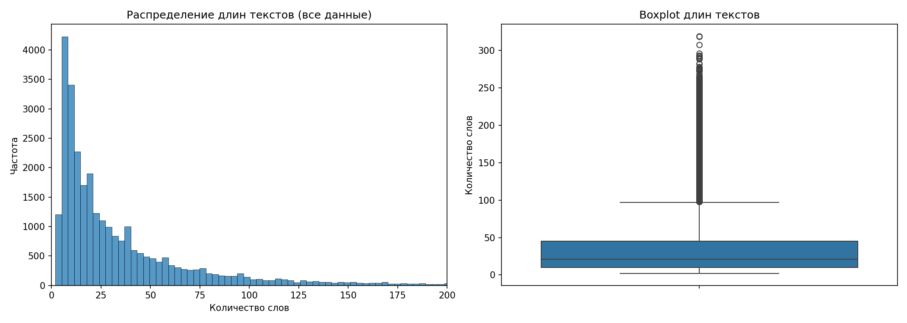

### Vocabulary analysis
**Overall dictionary statistics:**
- Total words (including repetitions): 1,030,639
- Unique words: 80,303

**Rare words (occurring once):**
- Count: 40,663
- Share of the vocabulary: 50.6%
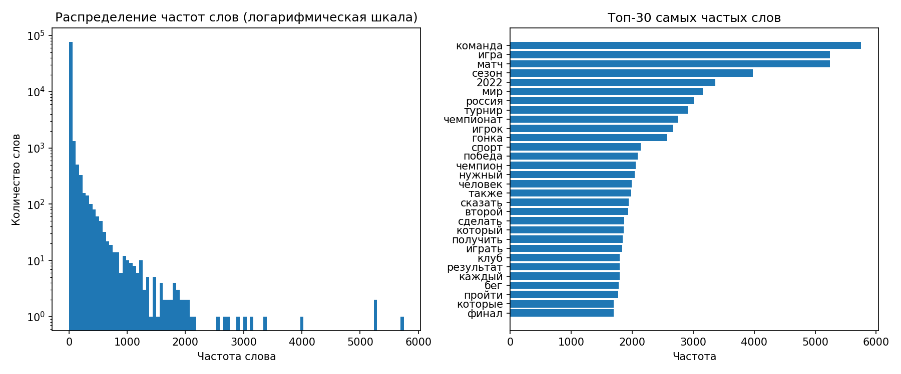

### Recommendations for Deep Learning Models

**Recommended hyperparameters:**
1. max_length (MAX_SEQ_LENGTH): 121
- Covers 95% of texts
- Information loss: ~5% of texts will be truncated
- Padding: ~70% of tokens will be <PAD>

2. vocab_size (MAX_VOCAB_SIZE): 10,000
- Limit the vocabulary to the top 10,000 words
- Rare words will be replaced with <UNK>

3. embedding_dim: 100–300
- 100: faster, requires less memory
- 300: higher quality, but slower

### The test of DataLoader for Deep Learning models
Checking the first batch:
- Texts shape: `torch.Size([64, 128])` - The batch contains 64 texts, and each has a length of exactly 128.
- Labels shape: `torch.Size([64])`
- Example of text (first 20 indices): tensor([138, 429, 955, 429, 2026, 7371, 3182, 405, 124, 7763, 827, 965, 156, 746, 2389, 1866, **1**, 81, 4384, 340]) - The **1** in the tensor is our `<UNK>` token. It means that a rare word - the one not included in the top 10,000 - appeared in this text.
- Label: 12 -> winter_sport - Mapping strings to numbers (`word2idx`) and back (`idx2word`) works correctly.
- Number of `<PAD>` tokens: 0 - In this particular text from the first batch, there were 128 words or more. Consequently, `truncation` occurred instead of `padding`.

### Analysis of results after training FCN on text data
1. **Early stopping worked perfectly:**
- The model continued to improve up to **the 7th epoch** (Val Acc: `75.98%`, Val Loss: `0.9031`).
- There were **no improvements** during epochs 8, 9, and 10.
- At the 10th epoch, the `patience=3` condition was met, training stopped, and the script automatically reverted the model weights to those from the best epoch - the 7th. **This saved the model from overfitting.**
```bash
2026-11-07 23:15:13,505 - INFO - Starting training
 - Starting training on the device: CPU
 - Epoch 1: New record! Val Loss: 1.7282, Val Acc: 0.4920                          
 - Epoch 2: New record! Val Loss: 1.2825, Val Acc: 0.6296                          
 - Epoch 3: New record! Val Loss: 1.1007, Val Acc: 0.6843                          
 - Epoch 4: New record! Val Loss: 1.0055, Val Acc: 0.7147                          
 - Epoch 5: New record! Val Loss: 0.9633, Val Acc: 0.7362                          
 - Epoch 6: New record! Val Loss: 0.9220, Val Acc: 0.7460                          
 - Epoch 7: New record! Val Loss: 0.9031, Val Acc: 0.7598
 - Epoch 8: No improvement (1/3)
 - Epoch 9: No improvement (2/3)
 - Epoch 10: No improvement (3/3)
 - Early stopping triggered at epoch 10.
 - The best weights were from the epoch 7 with Val Loss: 0.9031
```
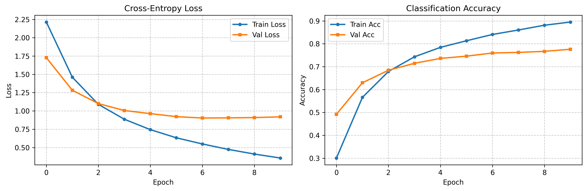

**Final accuracy (FCN)**: 77.62%

### Inference analysis of a Deep Learning model (FCN)

Beyond accuracy metrics, the model’s behavior on new data is critically important. Testing on control cases has shown:
```bash
| Test      | Prediction | Confidence | Comment                                                             |
| Football  | football   | 78.64%     | Confidence is slightly lower due to general terms                   |
|           |            |            | (`сборная`, `победа`) that are also common in other sports          |
| F-1       | autosport  | 100.00%    | The model has learned specific semantic clusters exceptionally well |
| Café (OOD)| volleyball | 40.95%     | Confidence drops sharply, as the model "realizes" that the text     |
|           |            |            | is far removed from the realm of sports                             |
| Garbage   | Rejected   | 0.00%      | The preprocessing step correctly filters out empty input before it  |
|           |            |            | reaches the neural network stage                                    |
```

### Selection of the model
Let’s compare this with previous experiments:
```bash
| Model               | Vectorizer            | Size   | Accuracy (Val) | Training time |
| Logistic Regression | TF-IDF (N-grams)      | 10 000 | 81.29%         | ~3 sec        |
| CatBoost            | TF-IDF + TruncatedSVD | 150    | 69.41%         | ~1.5 min      |
| Logistic Regression | E5 Embeddings         | 384    | 75.72%         | ~2 sec        |
| CatBoost            | E5 Embeddings         | 384    | 72.01%         | ~3.5 min      |
| FCN (PyTorch)       | Word Embeddings       | 100    | 77.62%         | ~30 sec       |
```

**Conclusion:** A simple FCN architecture with learnable embeddings proved to be a robust solution (`77.62% accuracy`), outperforming heavy pre-trained embeddings (`E5 + LR: 75.72%`) due to better adaptation to the specific sports slang present in the dataset. This proves that for highly specialized domains (like sport), training your own embeddings from scratch often works better than using general-purpose models.

## Tech
- 'Python 3.10+'
- 'scikit-learn', 'CatBoost'
- 'NLTK', 'spaCy'
- 'pandas', 'numpy'
- 'sentence_transformers'
- 'torch', 'torchtext'

