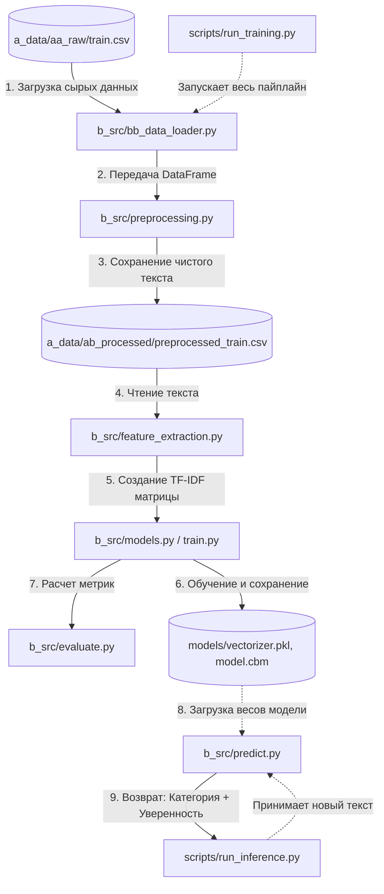

# nlp_tfidf_logreg_catboost


## Roadmap (План разработки)

- [x] Project structure creating
- [x] Raw data uploading and validation (`bb_data_loader.py`)
- [x] Exploratory Data Analysis (EDA)
- [x] Text pre-processing (`bc_preprocessing.py`)
- [ ] Features creation (TF-IDF)
- [ ] Model training and comparison (Logistic Regression vs CatBoost)
- [ ] Inference (`run_inference.py`)
- [ ] Final documentation and refactoring

# Sports Text Classifier 

Sports news classifier with four categories: **winter_sport**, **football**, **tennis**, **autosport**.

## EDA
### Analysis of the target variable (Classes)
1. Perfect balance – All 13 categories have roughly the same number of posts (1,962–2,412). This means we won't have to deal with class imbalance when training the models.
2. Duplicates removed: 2,966 duplicates (almost 8% of the data) – a good cleaning result.


### Text length statistics
Strong right skew:
1. Most texts are short (0–100 words)
2. There is a long tail of infrequent long texts (up to 504 words)
3. This is typical for social media: many short posts, few long articles
Key figures:
1. min = 4 words – very low; 4-word texts are almost useless for classification
2. median = 35 words – half of all texts are shorter than 35 words
3. mean = 61 words – average length (higher than the median due to long texts)
4. max = 504 words – includes full-length articles


### Number of texts with a length of ≤ 10 words: 2,484
2,484 texts (8.7% of the total) is not a large number. And most importantly: they are meaningful.
Examples:
- "Пожалуй празднования гола лучше в этом сезоне уже не будет"
- "Даниил Медведев передает привет из солнечного Монако"
- "Фабрицио Романо сообщает что Тен Хаг подписал контракт с МЮ"
Short texts do not need to be deleted. They contain information, and the model can classify them.

### Frequency analysis (searching for noise and patterns)
Analysis of the top 20 words and the top 15 category words revealed:
- Many stop words – we will handle this using NLTK
- "33" is an artifact – we will remove it
- There are standalone digits that carry no meaning – we will remove them


### Частотный анализ и Распределение длины текстов ПОСЛЕ очистки и лемматизации
Слова-паразиты (нужно добавить в стоп-слова):
- Местоимения и частицы
    'я', 'мы', 'все', 'это', 'тот', 'та', 'так', 'же', 'бы', 'ли',
    'свой', 'наш', 'ваш', 'его', 'её', 'их', 'мой', 'твой',
- Наречия и прилагательные (слишком общие)
    'очень', 'хороший', 'новый', 'первый', 'последний', 'большой',
- Глаголы-связки
    'стать', 'быть', 'являться',
- Общие существительные
    'день', 'время', 'место', 'год', 'раз', 'часть', 'сторона'


### Финальная очистка
- Слова "свой", "наш", "хороший", "стать", "первый", "быть", "новый" исчезли из топа
- Средняя длина текста уменьшилась с 38.68 до 36.89 слов
- В топе теперь больше спортивных терминов: "команда", "игра", "матч", "сезон", "турнир", "чемпионат", "игрок", "гонка", "победа", "чемпион"

## Быстрый старт

```bash
# Клонировать репозиторий
git clone <repo-url>
cd sports-classifier-tfidf

# Создать виртуальное окружение
python -m venv venv
source venv/bin/activate  # Linux/Mac
venv\Scripts\activate     # Windows

# Установить зависимости
pip install -r requirements.txt

# Запустить обучение
python scripts/run_training.py

# Сделать предсказание
python scripts/run_inference.py --text "Футбольный матч завершился победой сборной России"
```

## Результаты

## Архитектура


## Структура проекта


## Примеры использования

## Технологии
- 'Python 3.10+'
- 'scikit-learn', 'CatBoost'
- 'NLTK', 'spaCy'
- 'pandas', 'numpy'

