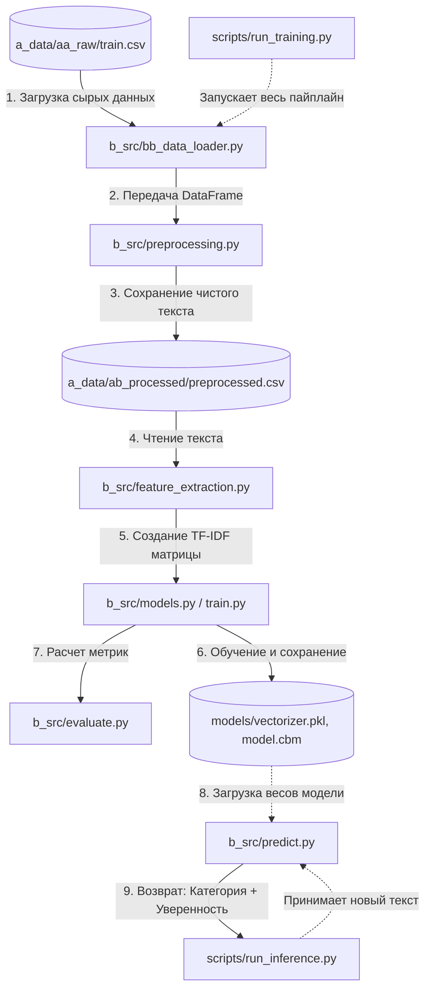

# nlp_tfidf_logreg_catboost


## Roadmap (План разработки)

- [x] Project structure creating
- [x] Raw data uploading and validation (`bb_data_loader.py`)
- [x] Exploratory Data Analysis (EDA)
- [ ] Text pre-processing (`preprocessing.py`)
- [ ] Features creation (TF-IDF)
- [ ] Model training and comparison (Logistic Regression vs CatBoost)
- [ ] Inference (`run_inference.py`)
- [ ] Final documentation and refactoring

# Sports Text Classifier 

Классификатор спортивных новостей на 4 категории: **winter_sport**, **football**, **tennis**, **autosport**.

## EDA
### Анализ целевой переменной (Классы)
1. Идеальный баланс - Все 13 категорий имеют примерно одинаковое количество постов (1962 - 2412). Это значит, что нам не придется бороться с дисбалансом классов при обучении моделей.
2. Дубликаты удалены: 2966 дубликатов (почти 8% данных) - это хороший результат очистки.


### Статистика длины текста
Сильное правостороннее смещение:
1. Большинство текстов короткие (0-100 слов)
2. Есть длинный хвост с редкими длинными текстами (до 504 слов)
3. Это типично для соцсетей: много коротких постов, мало длинных статей
Ключевые цифры:
1. min = 4 слова - это очень мало. Тексты из 4 слов почти бесполезны для классификации
2. median = 35 слов - половина всех текстов короче 35 слов
3. mean = 61 слово - средняя длина (выше медианы из-за длинных текстов)
4. max = 504 слова - есть полноценные статьи


### Количество текстов длиной <= 10 слов: 2484
2484 текста (8.7% от всех) - это немного. И главное: они осмысленные.
Примеры:
- "Пожалуй празднования гола лучше в этом сезоне уже не будет"
- "Даниил Медведев передает привет из солнечного Монако"
- "Фабрицио Романо сообщает что Тен Хаг подписал контракт с МЮ"
Короткие тексты не нужно удалять. Они несут информацию и модель может их классифицировать.

### Частотный анализ (Поиск мусора и паттернов)
Анализ Топ-20 слов и Топ-15 слов категории показал:
- Много стоп-слов - решим с помощью NLTK
- 33 - артефакт удалим
- есть одиночные цифры не несут смысла - удалим


## Быстрый старт

```bash
# Клонировать репозиторий
git clone <repo-url>
cd sports-classifier-tfidf

# Создать виртуальное окружение
python -m venv venv
source venv/bin/activate  # Linux/Mac
venv\Scripts\activate     # Windows

# Установить зависимости
pip install -r requirements.txt

# Запустить обучение
python scripts/run_training.py

# Сделать предсказание
python scripts/run_inference.py --text "Футбольный матч завершился победой сборной России"
```

## Результаты

## Архитектура


## Структура проекта


## Примеры использования

## Технологии
- 'Python 3.10+'
- 'scikit-learn', 'CatBoost'
- 'NLTK', 'spaCy'
- 'pandas', 'numpy'

