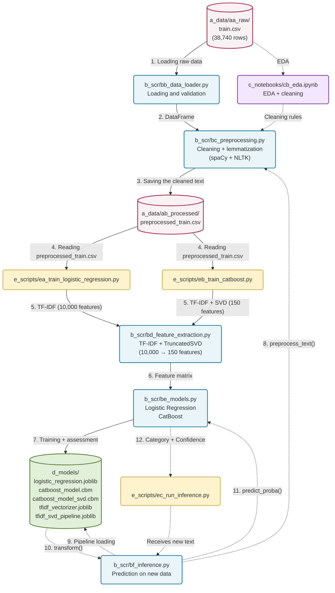
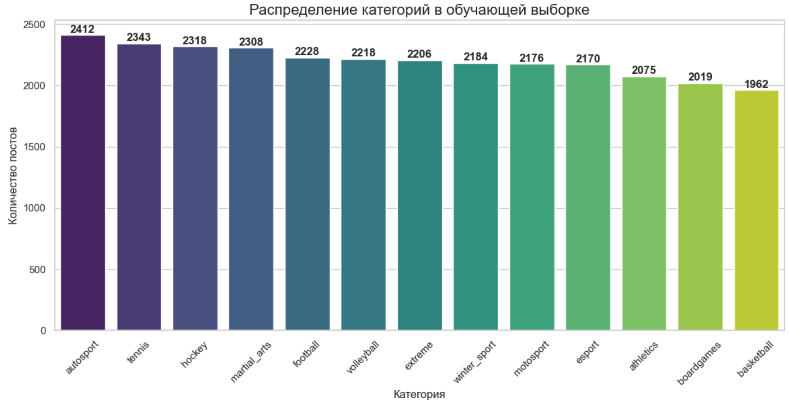
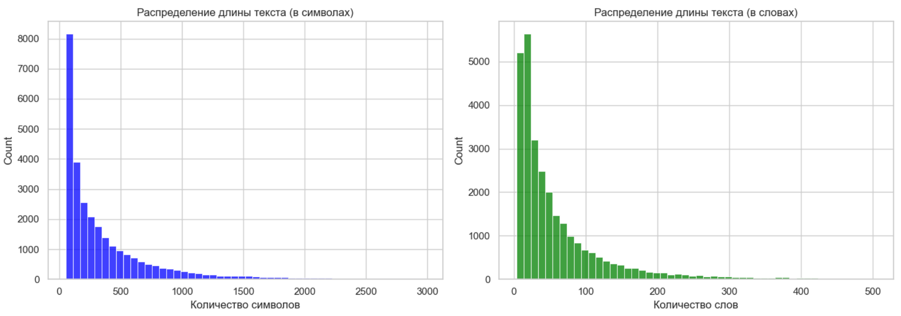
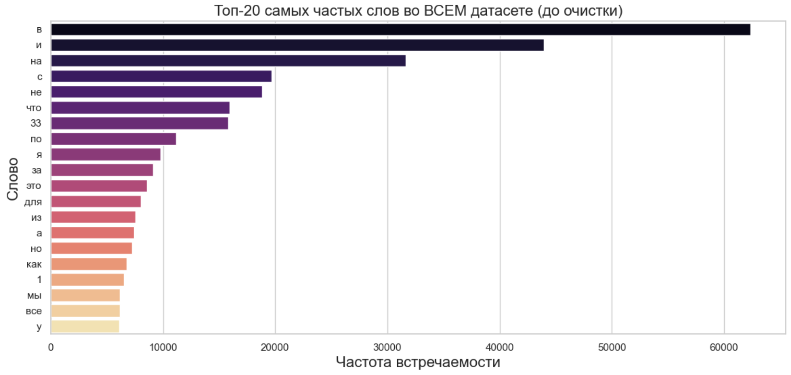
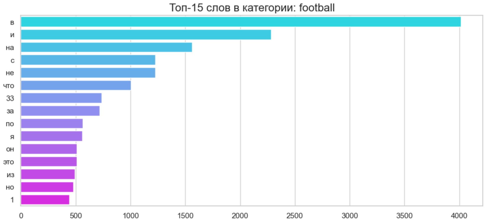
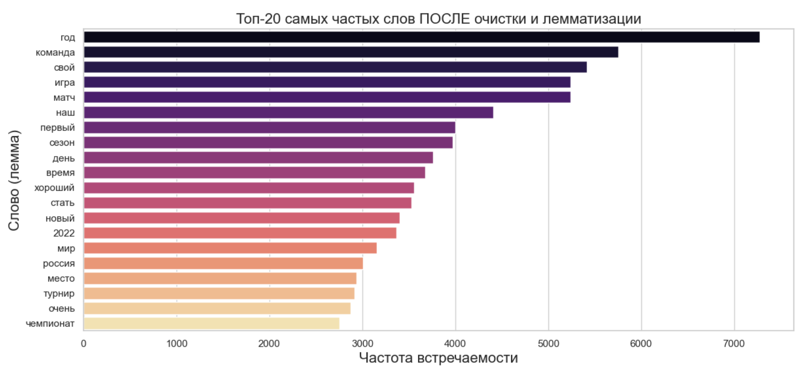
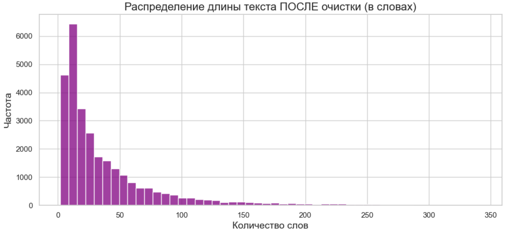

# nlp_tfidf_logreg_catboost


## Roadmap

- [x] Project structure creating
- [x] Raw data uploading and validation (`bb_data_loader.py`)
- [x] Exploratory Data Analysis (EDA)
- [x] Text pre-processing (`bc_preprocessing.py`)
- [x] Features creation (TF-IDF)
- [x] Model training and comparison (Logistic Regression vs CatBoost)
- [x] Increasing the number of components (CatBoost + TruncatedSVD)
- [x] Inference (`ec_run_inference.py` Logistic Regression and CatBoost + TruncatedSVD)
- [x] Pretrained Embeddings extraction (`bg_embedding_extractor.py`)
- [ ] Pretrained Embeddings Inference (`ee_train_embeddings.py` Logistic Regression and CatBoost)
- [ ] Final documentation

# Sports Text Classifier 

Sports news classifier with 13 categories: **winter_sport**, **football**, **tennis**, **autosport** and so on.
**Dataset URL:** https://www.kaggle.com/datasets/mikhailma/russian-social-media-text-classification

Implemented models:
- TF-IDF (Logistic Regression, CatBoost, CatBoost + TruncatedSVD)
- Pretrained Embeddings (Logistic Regression, CatBoost)

## Fast start

```bash
# Clone the repository
git clone <repo-url>
cd sports-classifier-tfidf

# Create a virtual environment
python -m venv venv
source venv/bin/activate  # Linux/Mac
venv\Scripts\activate     # Windows

# Install dependencies
pip install -r requirements.txt
python -m spacy download ru_core_news_sm

# Model training
# Logistic Regression (baseline)
python e_scripts/ea_train_logistic_regression.py

# CatBoost with SVD
python e_scripts/eb_train_catboost.py

# Inference testing
python e_scripts/ec_run_inference.py --text "Футбольный матч завершился победой сборной России"
```

## Architecture



## Project structure
```bash
nlp_tfidf_logreg_catboost/
│
├── a_data/                          # Project data
│   ├── aa_raw/                      # Raw, original data
│   │   └── train.csv                   # Original dataset from Kaggle (38,740 rows)
│   └── ab_processed/                # Processed data
│       └── preprocessed_train.csv      # Cleaned text after preprocessing
│
├── b_scr/                           # Source code
│   ├── ba_config.py                    # Configuration: paths, constants, parameters
│   ├── bb_data_loader.py               # Raw data loading and validation
│   ├── bc_preprocessing.py             # Text cleaning and lemmatization (spaCy + NLTK)
│   ├── bd_feature_extraction.py        # Feature extraction (TF-IDF + TruncatedSVD)
│   ├── be_models.py                    # Model training (Logistic Regression, CatBoost)
│   └── bf_inference.py                 # Inference: making predictions on new data
│
├── c_notebooks/                     #  Jupyter-notebooks for research
│   ├── logs/                        # Script execution logs
│   │   └── data_loader_20261013.log
│   ├── ca_check_data.ipynb             # Data loader verification
│   └── cb_eda.ipynb                    # Exploratory Data Analysis (EDA)
│
├── d_models/                        # Trained models and artifacts
│   ├── logistic_regression.joblib      # Best-performing model from the TF-IDF (Accuracy: 81.29%)
│   ├── catboost_model.cbm              # CatBoost model trained on raw TF-IDF features
│   ├── catboost_model_svd.cbm          # CatBoost trained on features after SVD (150 components)
│   ├── tfidf_vectorizer.joblib         # TF-IDF vectorizer for inference
│   └── tfidf_svd_pipeline.joblib       # TF-IDF + SVD pipeline for inference
│
├──  e_scripts/                       # Entry points
│   ├── ea_train_logistic_regression.py # Training Logistic Regression
│   ├── eb_train_catboost.py            # Training CatBoost (with optional SVD)
│   └── ec_run_inference.py             # Testing inference using examples
│
├── plots/                           #  Visualizations from EDA
│   ├── image-1.png                     # Text lengths (before cleaning)
│   ├── image-2.png                     # Top 20 words (before cleaning)
│   ├── image-3.png                     # Top 15 words in the 'football' category
│   ├── image-4.png                     # Top 20 words (after cleaning)
│   ├── image-5.png                     # Text lengths (after cleaning)
│   └── image.png                       # Category distribution
│
├── .gitignore                          # Git exclusions (data, cache, logs)
├── LICENSE
├── README.md                           # Project documentation
└── requirements.txt
```

## EDA
### Analysis of the target variable (Classes)
1. Perfect balance – All 13 categories have roughly the same number of posts (1,962–2,412). This means we won't have to deal with class imbalance when training the models.
2. Duplicates removed: 2,966 duplicates (almost 8% of the data) – a good cleaning result.



### Text length statistics
Strong right skew:
1. Most texts are short (0–100 words)
2. There is a long tail of infrequent long texts (up to 504 words)
3. This is typical for social media: many short posts, few long articles
Key figures:
1. min = 4 words – very low; 4-word texts are almost useless for classification
2. median = 35 words – half of all texts are shorter than 35 words
3. mean = 61 words – average length (higher than the median due to long texts)
4. max = 504 words – includes full-length articles



### Number of texts with a length of ≤ 10 words: 2,484
2,484 texts (8.7% of the total) is not a large number. And most importantly: they are meaningful.
Examples:
- "Пожалуй празднования гола лучше в этом сезоне уже не будет"
- "Даниил Медведев передает привет из солнечного Монако"
- "Фабрицио Романо сообщает что Тен Хаг подписал контракт с МЮ"
Short texts do not need to be deleted. They contain information, and the model can classify them.

### Frequency analysis (searching for noise and patterns)
Analysis of the top 20 words and the top 15 category words revealed:
- Many stop words – we will handle this using NLTK
- "33" is an artifact – we will remove it
- There are standalone digits that carry no meaning – we will remove them




### Frequency analysis and text length distribution AFTER cleaning and lemmatization
Filler words (should be added to the stop-word list):
- Pronouns and particles
    'я', 'мы', 'все', 'это', 'тот', 'та', 'так', 'же', 'бы', 'ли',
    'свой', 'наш', 'ваш', 'его', 'её', 'их', 'мой', 'твой',
- Adverbs and adjectives (too general)
    'очень', 'хороший', 'новый', 'первый', 'последний', 'большой',
- Linking verbs
    'стать', 'быть', 'являться',
- Common nouns
    'день', 'время', 'место', 'год', 'раз', 'часть', 'сторона'




### Final cleaning
- The words "свой", "наш", "хороший", "стать", "первый", "быть", "новый" have disappeared from the top list.
- The average text length decreased from 38.68 to 36.89 words
- There are now more sports terms among the top entries: "команда", "игра", "матч", "сезон", "турнир", "чемпионат", "игрок", "гонка", "победа", "чемпион"

## Model training and comparison (Logistic Regression vs CatBoost vs CatBoost + TruncatedSVD)

### Logistic Regression on TF-IDF features
```bash
2026-10-18 03:00:48,507 - INFO -  - Logistic Regression - Accuracy: 0.8129 (81.29%)
2026-10-18 03:00:48,654 - INFO - Classification Report:
              precision    recall  f1-score   support

   athletics       0.93      0.85      0.89       415
   autosport       0.88      0.82      0.85       482
  basketball       0.88      0.80      0.84       392
  boardgames       0.89      0.94      0.91       404
      esport       0.64      0.75      0.69       434
     extreme       0.54      0.76      0.64       441
    football       0.82      0.74      0.78       446
      hockey       0.84      0.81      0.82       464
martial_arts       0.77      0.73      0.75       462
   motosport       0.88      0.82      0.85       435
      tennis       0.97      0.92      0.94       469
  volleyball       0.90      0.79      0.84       443
winter_sport       0.81      0.84      0.83       437

    accuracy                           0.81      5724
   macro avg       0.83      0.81      0.82      5724
weighted avg       0.83      0.81      0.82      5724
```
Champions (F1 > 0.85):
- `tennis` (0.94), `board games` (0.91), `athletics` (0.89), `volleyball` (0.84), `autosport` (0.85), and `motorsports` (0.85).
- These categories have a very specific vocabulary. Terms such as `шлем`, `трасса`, `шайба`, `настольная` and `спринт` appear almost exclusively within their respective categories. TF-IDF assigns them very high weights, making them easy for the model to detect.

Underperformers (F1 < 0.75):
- `extreme` (0.64), `esport` (0.69), `martial arts` (0.75), and `football` (0.78).
- Overlapping vocabulary: Words like `игра`, `матч`, `победа`, `команда`, and `турнир` are used across all these categories. TF-IDF identifies these as high-frequency terms and lowers their weight.
- Class similarity: `extreme` and `martial arts` may describe similar actions (e.g., `удар`, `тренировка`, `соревнование`). `esport` may employ terminology similar to that used for conventional games.

### CatBoost on TF-IDF features
```bash
2026-10-18 22:11:49,079 - INFO -  - CatBoost - Accuracy: 0.6890 (68.90%)
2026-10-18 22:11:49,215 - INFO - Classification Report:
              precision    recall  f1-score   support

   athletics       0.94      0.71      0.81       415
   autosport       0.86      0.75      0.80       482
  basketball       0.97      0.58      0.73       392
  boardgames       0.75      0.79      0.77       404
      esport       0.60      0.57      0.58       434
     extreme       0.27      0.78      0.41       441
    football       0.72      0.60      0.65       446
      hockey       0.72      0.71      0.71       464
martial_arts       0.82      0.52      0.64       462
   motosport       0.84      0.71      0.77       435
      tennis       0.88      0.86      0.87       469
  volleyball       0.91      0.67      0.77       443
winter_sport       0.76      0.71      0.73       437

    accuracy                           0.69      5724
   macro avg       0.77      0.69      0.71      5724
weighted avg       0.77      0.69      0.71      5724
```
When comparing `Logistic Regression` and `CatBoost`, accuracy dropped from 81.29% (Logistic Regression) to 68.90% (CatBoost).

1. **Nature of the data (Sparsity)**: The `X_train` matrix has dimensions (22895, 10000). This means there are 10,000 features, approximately 99% of which are zeros (since any single text uses only a tiny fraction of the 10,000 available words).
2. **Logistic Regression** performs well with sparse data. A linear model simply assigns a high weight to relevant words (for example, `шайба` might be associated with `hockey`) and ignores the zeros.
3. **Decision trees (such as CatBoost)** do not handle sparse data well. At each step, a tree attempts to find a single feature that best splits the data. When 99% of the features are zeros, the tree ends up `guessing` and constructing overly complex, convoluted rules, which leads to overfitting on noise.

In the experiments, `Logistic Regression` (81.3%) outperformed `CatBoost` (68.9%) when using raw TF-IDF features. This result is expected, given the high sparsity of the feature matrix (10,000 columns, ~99% zeros) - a condition that linear models handle better than tree-based ensembles. To improve CatBoost's performance, the use of dimensionality reduction (**TruncatedSVD**) is recommended.

### CatBoost on TF-IDF features + TruncatedSVD
**Hypothesis**: Increasing the number of components from 150 to 500 will provide the model with new, useful information and increase Accuracy up to 78-83%.
```bash
2026-10-19 02:08:09,897 - INFO -  - CatBoost (SVD) - Accuracy: 0.6941 (69.41%)
2026-10-19 02:08:10,022 - INFO - Classification Report:
              precision    recall  f1-score   support

   athletics       0.86      0.80      0.83       415
   autosport       0.81      0.74      0.77       482
  basketball       0.72      0.67      0.70       392
  boardgames       0.80      0.80      0.80       404
      esport       0.52      0.55      0.54       434
     extreme       0.39      0.64      0.49       441
    football       0.68      0.58      0.63       446
      hockey       0.71      0.72      0.72       464
martial_arts       0.68      0.59      0.63       462
   motosport       0.81      0.74      0.77       435
      tennis       0.87      0.88      0.87       469
  volleyball       0.76      0.58      0.66       443
winter_sport       0.66      0.73      0.69       437

    accuracy                           0.69      5724
   macro avg       0.71      0.69      0.70      5724
weighted avg       0.71      0.69      0.70      5724
```
- **Accuracy**: 69.04% to 69.41% (a change within the margin of statistical error, meaning no actual improvement).
- **Training time**: 1.5 minutes to 4.5 minutes (a 3-fold increase).
**Conclusion**: The hypothesis was not supported. Increasing the number of components from 150 to 500 did not provide the model with any new, useful information; instead, it merely added computational noise. The first 150 SVD components already captured ~85–90% of the meaningful variance (semantic topics) in this dataset. The remaining 350 components consist primarily of noise and infrequent, unstable word combinations, which only hinder the decision trees from establishing clear rules.

### Comparison of models using TF-IDF features:
In our experiments, `Logistic Regression` (81.3%) significantly outperformed `CatBoost` (~69%).
We tested the hypothesis that decision trees are hindered by high data sparsity (10,000 features). To investigate this, we applied dimensionality reduction to obtain dense features using TruncatedSVD (with 150 and 500 components).

**Result**: Compressing the data accelerated CatBoost training by a factor of 6, but did not yield any improvement in performance. This confirms that for text classification tasks based on word frequencies (TF-IDF), linear models serve as an optimal baseline, as they are better suited for handling sparse, discrete signals.

## Inference Results on Test Texts

Following the training of both models, a blind test was conducted using 7 texts (including out-of-domain samples and "garbage" input).

**Key Findings:**
- **Logistic Regression** demonstrated higher accuracy and better-calibrated confidence scores.
- **CatBoost + SVD** misclassified an obvious text about football (predicting "hockey" instead), which suggests a loss of information during feature compression.
- For an **out-of-domain text** (about a café), `Logistic Regression (LR) returned a confidence score of 16%`, while `CatBoost returned 34%`. This makes LR a safer choice for production environments, where a threshold for filtering out "non-sports" content is essential.

**Decision:** `Logistic Regression` is selected for the TF-IDF-based production pipeline, as it serves as a more reliable and interpretable baseline.

## Tech
- 'Python 3.10+'
- 'scikit-learn', 'CatBoost'
- 'NLTK', 'spaCy'
- 'pandas', 'numpy'

