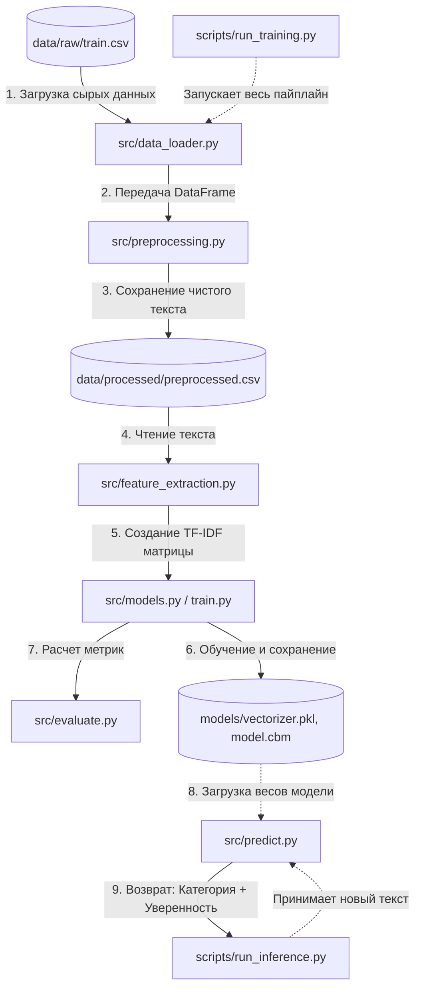

# nlp_tfidf_logreg_catboost

# Sports Text Classifier 

Классификатор спортивных новостей на 4 категории: **winter_sport**, **football**, **tennis**, **autosport**.

## Быстрый старт

```bash
# Клонировать репозиторий
git clone <repo-url>
cd sports-classifier-tfidf

# Создать виртуальное окружение
python -m venv venv
source venv/bin/activate  # Linux/Mac
venv\Scripts\activate     # Windows

# Установить зависимости
pip install -r requirements.txt

# Запустить обучение
python scripts/run_training.py

# Сделать предсказание
python scripts/run_inference.py --text "Футбольный матч завершился победой сборной России"
```

## Результаты

## Архитектура


## Структура проекта


## Примеры использования

## Технологии
- 'Python 3.10+'
- 'scikit-learn', 'CatBoost'
- 'NLTK', 'spaCy'
- 'pandas', 'numpy'

