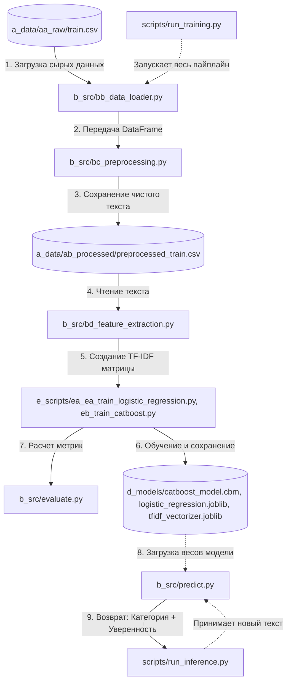

# nlp_tfidf_logreg_catboost


## Roadmap (План разработки)

- [x] Project structure creating
- [x] Raw data uploading and validation (`bb_data_loader.py`)
- [x] Exploratory Data Analysis (EDA)
- [x] Text pre-processing (`bc_preprocessing.py`)
- [x] Features creation (TF-IDF)
- [x] Model training and comparison (Logistic Regression vs CatBoost)
- [ ] Inference (`run_inference.py`)
- [ ] Final documentation and refactoring

# Sports Text Classifier 

Sports news classifier with four categories: **winter_sport**, **football**, **tennis**, **autosport**.

## EDA
### Analysis of the target variable (Classes)
1. Perfect balance – All 13 categories have roughly the same number of posts (1,962–2,412). This means we won't have to deal with class imbalance when training the models.
2. Duplicates removed: 2,966 duplicates (almost 8% of the data) – a good cleaning result.


### Text length statistics
Strong right skew:
1. Most texts are short (0–100 words)
2. There is a long tail of infrequent long texts (up to 504 words)
3. This is typical for social media: many short posts, few long articles
Key figures:
1. min = 4 words – very low; 4-word texts are almost useless for classification
2. median = 35 words – half of all texts are shorter than 35 words
3. mean = 61 words – average length (higher than the median due to long texts)
4. max = 504 words – includes full-length articles


### Number of texts with a length of ≤ 10 words: 2,484
2,484 texts (8.7% of the total) is not a large number. And most importantly: they are meaningful.
Examples:
- "Пожалуй празднования гола лучше в этом сезоне уже не будет"
- "Даниил Медведев передает привет из солнечного Монако"
- "Фабрицио Романо сообщает что Тен Хаг подписал контракт с МЮ"
Short texts do not need to be deleted. They contain information, and the model can classify them.

### Frequency analysis (searching for noise and patterns)
Analysis of the top 20 words and the top 15 category words revealed:
- Many stop words – we will handle this using NLTK
- "33" is an artifact – we will remove it
- There are standalone digits that carry no meaning – we will remove them


### Частотный анализ и Распределение длины текстов ПОСЛЕ очистки и лемматизации
Слова-паразиты (нужно добавить в стоп-слова):
- Местоимения и частицы
    'я', 'мы', 'все', 'это', 'тот', 'та', 'так', 'же', 'бы', 'ли',
    'свой', 'наш', 'ваш', 'его', 'её', 'их', 'мой', 'твой',
- Наречия и прилагательные (слишком общие)
    'очень', 'хороший', 'новый', 'первый', 'последний', 'большой',
- Глаголы-связки
    'стать', 'быть', 'являться',
- Общие существительные
    'день', 'время', 'место', 'год', 'раз', 'часть', 'сторона'


### Финальная очистка
- Слова "свой", "наш", "хороший", "стать", "первый", "быть", "новый" исчезли из топа
- Средняя длина текста уменьшилась с 38.68 до 36.89 слов
- В топе теперь больше спортивных терминов: "команда", "игра", "матч", "сезон", "турнир", "чемпионат", "игрок", "гонка", "победа", "чемпион"

## Быстрый старт

```bash
# Клонировать репозиторий
git clone <repo-url>
cd sports-classifier-tfidf

# Создать виртуальное окружение
python -m venv venv
source venv/bin/activate  # Linux/Mac
venv\Scripts\activate     # Windows

# Установить зависимости
pip install -r requirements.txt

# Запустить обучение
python scripts/run_training.py

# Сделать предсказание
python scripts/run_inference.py --text "Футбольный матч завершился победой сборной России"
```

## Model training and comparison (Logistic Regression vs CatBoost)

### Logistic Regression on TF-IDF features
```bash
2026-10-18 03:00:48,507 - INFO -  - Logistic Regression - Accuracy: 0.8129 (81.29%)
2026-10-18 03:00:48,654 - INFO - Classification Report:
              precision    recall  f1-score   support

   athletics       0.93      0.85      0.89       415
   autosport       0.88      0.82      0.85       482
  basketball       0.88      0.80      0.84       392
  boardgames       0.89      0.94      0.91       404
      esport       0.64      0.75      0.69       434
     extreme       0.54      0.76      0.64       441
    football       0.82      0.74      0.78       446
      hockey       0.84      0.81      0.82       464
martial_arts       0.77      0.73      0.75       462
   motosport       0.88      0.82      0.85       435
      tennis       0.97      0.92      0.94       469
  volleyball       0.90      0.79      0.84       443
winter_sport       0.81      0.84      0.83       437

    accuracy                           0.81      5724
   macro avg       0.83      0.81      0.82      5724
weighted avg       0.83      0.81      0.82      5724
```
Champions (F1 > 0.85):
- `tennis` (0.94), `board games` (0.91), `athletics` (0.89), `volleyball` (0.84), `autosport` (0.85), and `motorsports` (0.85).
- These categories have a very specific vocabulary. Terms such as `шлем`, `трасса`, `шайба`, `настольная` and `спринт` appear almost exclusively within their respective categories. TF-IDF assigns them very high weights, making them easy for the model to detect.

Underperformers (F1 < 0.75):
- `extreme` (0.64), `esport` (0.69), `martial arts` (0.75), and `football` (0.78).
- Overlapping vocabulary: Words like `игра`, `матч`, `победа`, `команда`, and `турнир` are used across all these categories. TF-IDF identifies these as high-frequency terms and lowers their weight.
- Class similarity: `extreme` and `martial arts` may describe similar actions (e.g., `удар`, `тренировка`, `соревнование`). `esport` may employ terminology similar to that used for conventional games.

### CatBoost on TF-IDF features
```bash
2026-10-18 22:11:49,079 - INFO -  - CatBoost - Accuracy: 0.6890 (68.90%)
2026-10-18 22:11:49,215 - INFO - Classification Report:
              precision    recall  f1-score   support

   athletics       0.94      0.71      0.81       415
   autosport       0.86      0.75      0.80       482
  basketball       0.97      0.58      0.73       392
  boardgames       0.75      0.79      0.77       404
      esport       0.60      0.57      0.58       434
     extreme       0.27      0.78      0.41       441
    football       0.72      0.60      0.65       446
      hockey       0.72      0.71      0.71       464
martial_arts       0.82      0.52      0.64       462
   motosport       0.84      0.71      0.77       435
      tennis       0.88      0.86      0.87       469
  volleyball       0.91      0.67      0.77       443
winter_sport       0.76      0.71      0.73       437

    accuracy                           0.69      5724
   macro avg       0.77      0.69      0.71      5724
weighted avg       0.77      0.69      0.71      5724
```
When comparing `Logistic Regression` and `CatBoost`, accuracy dropped from 81.29% (Logistic Regression) to 68.90% (CatBoost).

1. Nature of the data (Sparsity): The `X_train` matrix has dimensions (22895, 10000). This means there are 10,000 features, approximately 99% of which are zeros (since any single text uses only a tiny fraction of the 10,000 available words).
2. Logistic Regression performs well with sparse data. A linear model simply assigns a high weight to relevant words (for example, `шайба` might be associated with `hockey`) and ignores the zeros.
3. Decision trees (such as CatBoost) do not handle sparse data well. At each step, a tree attempts to find a single feature that best splits the data. When 99% of the features are zeros, the tree ends up `guessing` and constructing overly complex, convoluted rules, which leads to overfitting on noise.

In the experiments, `Logistic Regression` (81.3%) outperformed `CatBoost` (68.9%) when using raw TF-IDF features. This result is expected, given the high sparsity of the feature matrix (10,000 columns, ~99% zeros) - a condition that linear models handle better than tree-based ensembles. To improve CatBoost's performance, the use of dimensionality reduction (TruncatedSVD) is recommended.

## Architecture


## Структура проекта


## Примеры использования

## Технологии
- 'Python 3.10+'
- 'scikit-learn', 'CatBoost'
- 'NLTK', 'spaCy'
- 'pandas', 'numpy'

